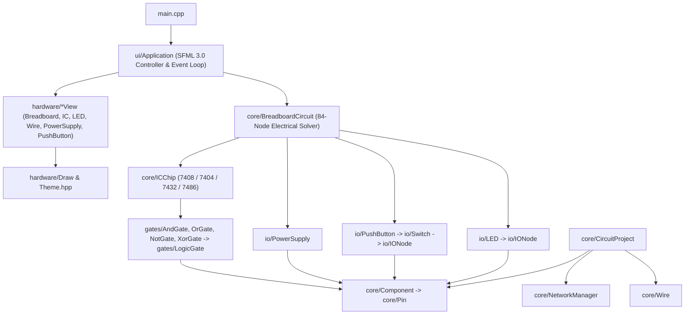
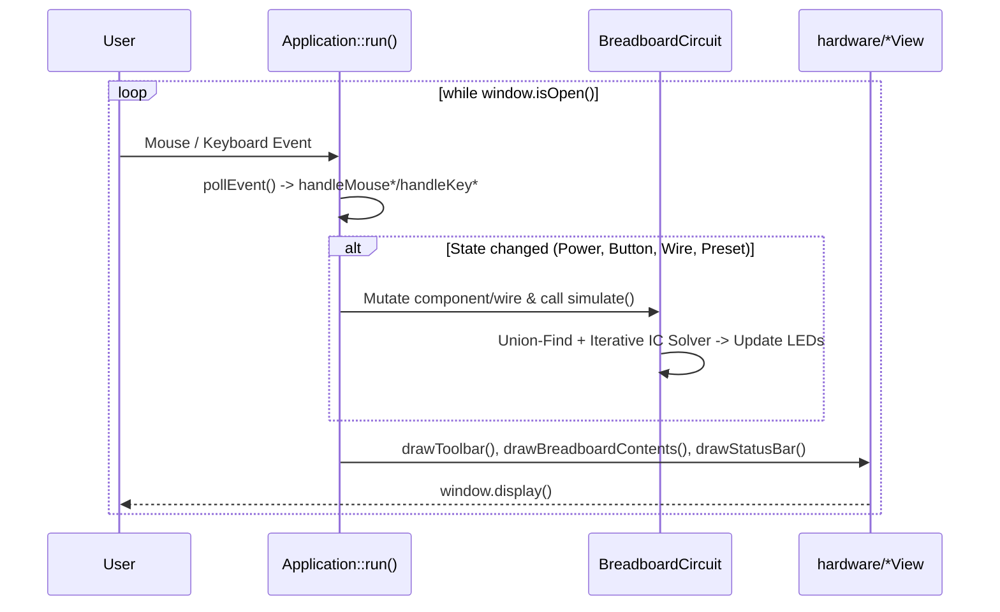

# Digital Logic Circuit Simulator — Engineering Architecture & API Reference

This document is the technical reference for the **Digital Logic Circuit Simulator** (C++17 / SFML 3.0). It explains the layered architecture, runtime execution flow, electrical breadboard solver, and every class/function implemented across the repository so contributors can maintain and extend the codebase safely.

---

## 1. System Architecture

The codebase is organized into strict layers so that **all simulation logic is decoupled from SFML rendering**. This enables headless unit testing (`tests/sim_test.cpp`) with a standard C++17 compiler and clean separation of concerns.

### Layer Responsibilities
| Directory | Dependency | Responsibility |
|---|---|---|
| `core/` | Pure C++17 STL | Domain primitives (`Pin`, `Component`, `Wire`), graph propagation (`NetworkManager`, `CircuitProject`), 14-pin TTL IC models (`ICChip`), and breadboard electrical solver (`BreadboardCircuit`). |
| `gates/` | `core/` | Polymorphic Boolean gate hierarchy (`LogicGate`, `AndGate`, `OrGate`, `NotGate`, `XorGate`). |
| `io/` | `core/` | Input/Output devices (`IONode`, `Switch`, `PushButton`, `LED`, `Clock`, `PowerSupply`). |
| `hardware/` | SFML 3.0 | Stateless/lightweight 2D visual components and drawing helpers (`Theme.hpp`, `Draw`, `BreadboardView`, `ICView`, `LEDView`, `WireView`, `PowerSupplyView`, `PushButtonView`). |
| `ui/` | `core/`, `io/`, `hardware/`, SFML 3.0 | Window management, input hit-testing, interactive wiring state machine, toolbar/status rendering (`Application`). |
| `tests/` | `core/`, `gates/`, `io/` | Headless automated verification (`sim_test.cpp`). |

---

## 2. Detailed Execution & Signal Flow

### 2.1 Application Startup Flow

1. **`main()`** (`main.cpp`) instantiates `Application` on the stack and calls `app.run()`.
2. **`Application::Application()`** (`ui/Application.cpp`):
   - Initializes `BreadboardCircuit circuit` (default constructor):
     - Creates the `5V DC` `PowerSupply` (initially **ON**).
     - Calls `setupBaseComponents()` to mount the 4 TTL ICs (`7408` at col 0, `7404` at col 8, `7432` at col 16, `7486` at col 24), 3 tactile push buttons (`BTN A` col 32, `BTN B` col 35, `BTN C` col 38 on `ROW_C`), and 3 LEDs (`RED` col 32, `GRN` col 35, `BLU` col 38 on `ROW_J`).
     - Calls `loadPreset(DemoPreset::BasicGates)` which inserts base power/ground wires and preset signal wires, then invokes `simulate()`.
   - Creates the `1060 × 510` SFML 3.0 `RenderWindow` with 8× anti-aliasing and 60 FPS cap.
   - Calls `loadSystemFont()` trying Windows (`arial.ttf`, `segoeui.ttf`, `consola.ttf`) and Linux/WSL (`DejaVuSans.ttf`, `LiberationSans-Regular.ttf`) font paths.
   - Calls `initToolbar()` to compute button hitboxes for presets, wire color swatches, undo, and reset.
   - Runs an initial `circuit.simulate()`.

### 2.2 Main Event & Render Loop (`Application::run()`)

The simulator is **event-driven for state updates** and **60 FPS for rendering**:

- **Mouse Press (`handleMousePress`)** resolves targets in strict priority order:
  1. Right-click: cancels an in-progress wire, or triggers momentary press on a `PushButton`.
  2. Left-click on top toolbar: switches preset (`BasicGates`, `InvertedGates`, `Sandbox`), selects active wire color, undoes last wire, or resets current preset.
  3. Left-click on `PowerSupplyView::containsSwitch`: toggles `powerSupply` ON/OFF and re-simulates.
  4. Left-click on `PushButtonView::contains`: toggles button latch (`toggleLatch()`) and re-simulates.
  5. Left-click near a breadboard hole (`findClosestBoardPoint`, 11 px snap radius): starts or completes a `JumperWire` and re-simulates.
- **Mouse Move**: updates `mouseWorldPos` and `hoverPoint` for the live rubber-band wire preview and bottom status-bar voltage/pin probe.
- **Keyboard (`handleKeyPress` / `handleKeyRelease`)**:
  - `1`, `2`, `3`: momentary press/release of `BTN A`, `BTN B`, `BTN C`.
  - `P`: toggle 5V power supply.
  - `F1`, `F2`, `F3`: load Presets 1, 2, 3.
  - `Backspace`: undo last wire.
  - `Esc`: cancel pending wire placement.

### 2.3 Electrical Breadboard Solver (`BreadboardCircuit::simulate()`)

A 40-column breadboard has **84 distinct electrical nodes**:
- Nodes `0..39`: Top vertical 5-hole strips (Columns `0..39`, Rows `A–E`).
- Nodes `40..79`: Bottom vertical 5-hole strips (Columns `0..39`, Rows `F–J`).
- Nodes `80..83`: The 4 horizontal power rails (`TOP_PLUS`, `TOP_MINUS`, `BOTTOM_PLUS`, `BOTTOM_MINUS`).

Every time `simulate()` runs, it resolves the entire board from scratch in 6 deterministic phases:

1. **Supply Evaluation**: Calls `powerSupply.evaluate()`.
2. **Connectivity (Union-Find / Disjoint Set Union)**:
   - Initializes 84 singleton sets.
   - For every `JumperWire`, unites `pointToNode(from)` and `pointToNode(to)`.
   - For every **currently pressed** `PushButton`, unites its left-leg strip (`col`) and right-leg strip (`col + 1`), electrically bridging `+5V` into its output strip.
3. **Power Seeding**:
   - If `powerSupply.isEnabled()` is `true`:
     - The connected component containing `TOP_PLUS` (node 80) is marked `compVcc = true` and `compHigh = true`.
     - The connected component containing `TOP_MINUS` (node 81) is marked `compGnd = true`.
   - If the supply is OFF, no component receives `compVcc` or `compGnd`.
4. **Iterative Cascading Gate Resolution (up to 16 passes)**:
   - Starts each pass with `nextHigh[i] = compVcc[i]`.
   - For each of the 4 `ICChip`s:
     - Checks whether Pin 14's component has `compVcc` **and** Pin 7's component has `compGnd`.
     - Reads all 14 pin logic levels from `compHigh[dsu.find(pinNode)]`.
     - Calls `chip.evaluate(...)`, which runs each internal `LogicGate` (`AndGate`, `NotGate`, `OrGate`, `XorGate`).
     - If the IC is powered (`hasVcc && hasGnd`), any output pin evaluating to `true` sets `nextHigh[dsu.find(outNode)] = true`.
   - Stops early as soon as `compHigh` converges (no node changes state), preventing infinite oscillation on feedback loops.
5. **Node State Snapshot**: Copies resolved component states into `nodeVcc[84]`, `nodeGnd[84]`, and `nodeHigh[84]` for UI probing.
6. **LED Forward-Bias Evaluation**:
   - Each LED lights up **if and only if**:
     `powerSupply.isEnabled() && nodeHigh[anodeNode] && nodeGnd[cathodeNode]`.

### 2.4 Schematic Engine Flow (`CircuitProject` & `NetworkManager`)

Alongside the breadboard solver, the proposal's schematic graph engine (`CircuitProject` + `NetworkManager`) is fully implemented for component-to-component pin wiring:
- `CircuitProject::addComponent` registers each `Component` with `NetworkManager` and takes ownership via `std::unique_ptr<Component>`.
- `CircuitProject::addWire` validates `Output -> Input` direction in `Wire::Wire`, stores ownership, and updates `NetworkManager`'s adjacency map (`Pin* -> vector<Wire*>`).
- `CircuitProject::update()` calls `NetworkManager::step()` when `SimulationState::Running`.
- `NetworkManager::step()` iteratively calls `Component::evaluate()`, propagates all `Wire`s, checks `Pin::isDirty()` / destination deltas, and terminates when stable or when `maxIterations` (default 64) is reached.

---

## 3. Complete Function & Class Reference

### 3.1 Entry Point

#### `main.cpp`
- **`int main()`**: Instantiates `Application` and returns `app.run()` (`0` on normal close, `1` if no system font could be loaded).

---

### 3.2 Core Simulation Engine (`core/`)

#### `Pin` (`core/Pin.hpp`, `core/Pin.cpp`)
Represents a single binary connection point belonging to a `Component`.
- **`Pin(Direction dir, Component* ownerComponent = nullptr)`**: Initializes pin direction (`Input` or `Output`), `signalState = false`, `dirty = false`, and back-pointer to owner.
- **`bool getState() const`**: Returns current logic level (`true` = HIGH, `false` = LOW).
- **`void setState(bool state)`**: Updates `signalState`; sets `dirty = true` only when the value actually changes.
- **`Direction getDirection() const`**: Returns `Direction::Input` or `Direction::Output`.
- **`Component* getOwner() const`** / **`void setOwner(Component* ownerComponent)`**: Gets/updates owning component pointer (updated automatically when `Component` is moved).
- **`bool isDirty() const`** / **`void clearDirty()`**: Tracks whether this pin changed during the current simulation tick.

#### `Component` (`core/Component.hpp`, `core/Component.cpp`)
Abstract base class for all logic gates and I/O devices. Moveable, non-copyable.
- **`Component(const std::string& type, const std::string& compLabel = "", int x = 0, int y = 0)`**: Assigns an auto-incrementing unique `id`, `deviceType`, `label`, and grid coordinates.
- **`virtual ~Component()`**: Virtual destructor for polymorphic cleanup.
- **`Component(Component&& other) noexcept`** / **`operator=(Component&& other) noexcept`**: Moves owned `pins` and re-points every `Pin::owner` to `this` so no dangling owner pointers occur when stored in `std::vector`.
- **`Pin* addPin(Pin::Direction dir)`** *(protected)*: Allocates and owns a new `Pin` bound to `this`.
- **`int getId() const`**: Returns unique auto-generated component ID.
- **`const std::string& getLabel() const`** / **`void setLabel(const std::string& newLabel)`**: Gets/sets display label.
- **`const std::string& getDeviceType() const`**: Returns type string (`"AND"`, `"OR"`, `"NOT"`, `"XOR"`, `"SWITCH"`, `"LED"`, `"CLOCK"`, `"POWER_5V"`).
- **`int getGridX() const`**, **`int getGridY() const`**, **`void setGridPosition(int x, int y)`**: Grid coordinates for canvas placement/serialization.
- **`std::vector<Pin*> getInputPins() const`** / **`std::vector<Pin*> getOutputPins() const`**: Filters owned pins by direction.
- **`Pin* getPin(std::size_t index) const`** / **`std::size_t getPinCount() const`**: Indexed pin access with bounds check.
- **`virtual void evaluate() = 0`**: Pure virtual evaluation hook implemented by subclasses.

#### `Wire` (`core/Wire.hpp`, `core/Wire.cpp`)
Directed signal link from one `Output` pin to one `Input` pin (non-owning).
- **`Wire(Pin* source, Pin* destination, const std::string& color = "Yellow")`**: Validates non-null endpoints and `Output -> Input` direction; throws `std::invalid_argument` if invalid.
- **`bool isValid() const`**: Verifies endpoint pointers and directions.
- **`void propagate()`**: Copies `sourcePin->getState()` into `currentSignal` and calls `destinationPin->setState(currentSignal)`.
- **`Pin* getSource() const`** / **`Pin* getDestination() const`**: Endpoint accessors.
- **`bool getSignal() const`**: Last propagated signal value.
- **`const std::string& getColor() const`** / **`void setColor(const std::string& color)`**: Color name metadata.
- **`const std::vector<std::pair<int, int>>& getRoutingPath() const`** / **`void setRoutingPath(...)`**: Optional grid waypoints.

#### `NetworkManager` (`core/NetworkManager.hpp`, `core/NetworkManager.cpp`)
Graph-based signal propagation engine for schematic circuits.
- **`explicit NetworkManager(int maxIter = 64)`**: Sets loop-detection iteration cap.
- **`void addComponent(Component* comp)`**: Registers a component (deduplicated).
- **`void removeComponent(Component* comp)`**: Unregisters component and removes all wires attached to any of its pins.
- **`void addConnection(Wire* wire)`**: Adds wire to wire list, updates `adjacency[sourcePin]`, and ensures both endpoint owners are registered.
- **`void removeConnection(Wire* wire)`**: Removes wire from wire list and `adjacency`.
- **`bool step()`**: Iteratively evaluates all components and propagates all wires until quiescent or `maxIterations` is hit. Returns `true` if settled, `false` if a combinational loop did not settle.
- **`void reset()`**: Resets all pin states to `false` and clears dirty flags.

#### `CircuitProject` (`core/CircuitProject.hpp`, `core/CircuitProject.cpp`)
Top-level schematic circuit container owning components, wires, and a `NetworkManager`.
- **`CircuitProject(const std::string& projectTitle = "Untitled Circuit", const std::string& date = "2026-11-24")`**: Initializes project metadata in `SimulationState::Running`.
- **`getTitle()` / `setTitle()` / `getCreationDate()`**: Project metadata accessors.
- **`getSimulationState()` / `start()` / `pause()` / `clear()`**: Simulation lifecycle controls (`clear()` destroys all wires/components and resets `NetworkManager`).
- **`Component* addComponent(std::unique_ptr<Component> comp)`**: Takes ownership, registers with `NetworkManager`, returns raw pointer.
- **`bool removeComponent(int componentId)`**: Deletes component and any wires connected to it.
- **`Component* findComponent(int componentId) const`**: Lookup by ID.
- **`Wire* addWire(Pin* source, Pin* destination, const std::string& color = "Yellow")`**: Constructs, registers, and owns a `Wire`.
- **`bool removeWire(Wire* wire)`**: Removes and destroys a `Wire`.
- **`void update()`**: Calls `network.step()` if `Running`.
- **`getComponents()` / `getWires()`**: Const read access for renderers and serializers.

#### `ICChip` (`core/ICChip.hpp`, `core/ICChip.cpp`)
Models a physical 14-pin DIP 74xx TTL IC composed of internal `LogicGate` objects.
- **`ICChip(ICType icType, int startCol)`**: Sets label (`"7408 AND"`, `"7404 NOT"`, `"7432 OR"`, `"7486 XOR"`), breadboard starting column, and calls `buildInternalGates()`.
- **`void buildInternalGates()`** *(private)*: Populates `internalGates` and `pinMaps` using real 74xx pinouts:
  - `7404`: 6 `NotGate`s — `(1→2), (3→4), (5→6), (9→8), (11→10), (13→12)`.
  - `7408`, `7432`, `7486`: 4 gates — `(1,2→3), (4,5→6), (9,10→8), (12,13→11)`.
- **`getType()` / `getLabel()` / `getFirstCol()` / `getPinCount()` / `isPowered()`**: Metadata and live power-state getters.
- **`int pinColumn(int pin) const`**: Maps 1-based pin `1..7` to `firstCol + (pin - 1)` and `8..14` to `firstCol + (14 - pin)`.
- **`bool pinIsTopHalf(int pin) const`**: Returns `true` for pins `8..14` (`ROW_E`), `false` for pins `1..7` (`ROW_F`).
- **`bool isOutputPin(int pin) const`**: Checks whether a pin is a gate output.
- **`std::string pinDescription(int pin) const`**: Returns human-readable tooltip text (e.g., `"7408 AND Pin 3 (Gate 1 Out Y)"`, `"7408 AND Pin 14 (VCC +5V)"`).
- **`void evaluate(bool hasVcc, bool hasGnd, const bool pinInputHigh[15], bool pinOutputHigh[15], bool pinOutputDriven[15])`**: Clears output arrays, sets `powered = hasVcc && hasGnd`, and if powered, drives each internal `LogicGate` and writes its output pin state.

#### `BreadboardCircuit` (`core/BreadboardCircuit.hpp`, `core/BreadboardCircuit.cpp`)
Pure C++17 breadboard model and 84-node electrical solver.
- **Helper structs**:
  - `BoardPoint`: Tagged coordinate (`isRail`, `col`, `index`) with factory helpers `BoardPoint::Hole(c, r)` and `BoardPoint::Rail(c, railIdx)`.
  - `JumperWire`: `{from, to, color, removable}`.
  - `BreadboardLED` / `BreadboardButton`: Wraps `LED` / `PushButton` with breadboard `(col, row)` placement and display `label`.
- **`BreadboardCircuit()`**: Initializes `5V DC` supply, calls `setupBaseComponents()`, and loads `DemoPreset::BasicGates`.
- **`void setupBaseComponents()`** *(private)*: Places the 4 ICs, 3 push buttons (`BTN A/B/C`), and 3 LEDs (`RED/GRN/BLU`).
- **`void addBasePowerWires()`** *(private)*: Bridges top/bottom power rails, connects Pin 14 (`VCC`) and Pin 7 (`GND`) of all 4 ICs, feeds `+5V` to button left legs, and grounds LED cathodes (automatically avoiding `col % 6 == 5` rail gaps).
- **`void loadPreset(DemoPreset preset)`**: Rebuilds wires for `BasicGates`, `InvertedGates`, or `Sandbox` and runs `simulate()`.
- **`getCurrentPreset()` / `getPresetName()`**: Returns active preset enum / UI title string.
- **`static int stripNode(int col, bool topHalf)`**: Maps `(col, topHalf)` to node `0..39` (top) or `40..79` (bottom).
- **`static int railNode(int railIndex)`**: Maps rail `0..3` to node `80..83`.
- **`static int pointToNode(const BoardPoint& pt)`**: Unified coordinate-to-node mapper.
- **`void simulate()`**: Runs the 6-phase Union-Find + iterative IC solver and updates all LEDs.
- **`void addWire(from, to, color)` / `bool removeLastWire()` / `bool removeWireAt(index)` / `void clearSignalWires()`**: Interactive wire editing API (each automatically triggers `simulate()`).
- **`getPowerSupply()` / `getICs()` / `getButtons()` / `getLEDs()` / `getWires()`**: Mutable and const accessors.
- **`isNodeHigh(id)` / `isNodeGnd(id)` / `isNodeVcc(id)` / `isPointHigh(pt)`**: Electrical state queries.
- **`std::string describePoint(const BoardPoint& pt) const`**: Builds the live probe description shown in the status bar (identifies rails, IC pins, button legs, LED legs, or generic column/row + voltage state).

---

### 3.3 Logic Gates (`gates/`)

- **`LogicGate`** (`LogicGate.{hpp,cpp}`):
  - **`LogicGate(type, inputCount, label, x, y)`**: Creates `inputCount` `Input` pins and 1 `Output` pin.
  - **`void evaluate() override`**: Collects input pin states into `std::vector<bool>`, calls `computeOutput()`, and writes the result to the output pin.
  - **`virtual bool computeOutput(const std::vector<bool>& inputs) const = 0`**: Truth-table hook.
  - **`Pin* getOutputPin() const`**: Returns the single output pin.
- **`AndGate`** (`AndGate.{hpp,cpp}`): `computeOutput` returns `true` iff all inputs are `true` (and non-empty).
- **`OrGate`** (`OrGate.{hpp,cpp}`): `computeOutput` returns `true` if any input is `true`.
- **`NotGate`** (`NotGate.{hpp,cpp}`): 1-input gate; `computeOutput` returns `!inputs[0]`.
- **`XorGate`** (`XorGate.{hpp,cpp}`): `computeOutput` computes odd parity across all inputs.

---

### 3.4 I/O Devices (`io/`)

- **`IONode`** (`IONode.{hpp,cpp}`): Abstract base for I/O components; provides `isInputDevice()` and `isOutputDevice()`.
- **`Switch`** (`Switch.{hpp,cpp}`): Single-output toggleable input (`isOn()`, `setState(bool)`, `toggle()`, `getOutputPin()`, `evaluate()`).
- **`PushButton`** (`PushButton.{hpp,cpp}`): Inherits `Switch`; tracks independent `momentaryPressed` and `latched` flags (`press()`, `release()`, `toggleLatch()`, `setLatched(bool)`, `isPressed()`, `isLatched()`), synced via `syncState()` so `state = momentaryPressed || latched`.
- **`LED`** (`LED.{hpp,cpp}`): Single-input indicator with `enum class Color { Red, Green, Blue, Yellow }`; provides `getColor()`, `isOn()`, `setLit(bool)`, `getInputPin()`, `evaluate()`.
- **`Clock`** (`Clock.{hpp,cpp}`): Periodic square-wave generator (`getPeriod()`, `setPeriod(float)`, `isHigh()`, `update(float dt)`, `getOutputPin()`, `evaluate()`).
- **`PowerSupply`** (`PowerSupply.{hpp,cpp}`): 5V DC supply (`isEnabled()`, `setEnabled(bool)`, `toggle()`, `getNominalVoltage()`, `getOutputVoltage()`, `getVccPin()`, `evaluate()`).

---

### 3.5 Hardware SFML 3.0 Views (`hardware/`)

- **`Draw`** (`Draw.{hpp,cpp}`):
  - **`drawRect(target, x, y, w, h, color)`**: Draws a filled `sf::RectangleShape`.
  - **`drawCircle(target, x, y, radius, color)`**: Draws a centered `sf::CircleShape`.
  - **`drawText(target, font, str, size, color, x, y)`**: Draws centered `sf::Text` using `getLocalBounds()`.
  - **`drawLine(target, a, b, thickness, color)`**: Draws a thick line segment as a 4-vertex `PrimitiveType::TriangleStrip`.
- **`BreadboardView`** (`BreadboardView.{hpp,cpp}`):
  - **`BreadboardView(Vector2f position)`**: Sets top-left origin.
  - **`Vector2f holePos(int col, int row)`**: Pixel center of main strip hole `(col, row)`.
  - **`Vector2f railPos(int col, int rail)`**: Pixel center of power rail hole `(col, rail)`.
  - **`void draw(RenderTarget& target)`**: Draws board body, center ravine, red/blue rail stripes, `+/-` signs, and holes (skipping `col % RAIL_GROUP == RAIL_GROUP - 1` on rails).
- **`ICView`** (`ICView.{hpp,cpp}`):
  - **`ICView(board, font, col, text, pinCount = 14)`**: Configures IC placement and label.
  - **`Vector2f pinPos(int pin)`**: Pixel center of 1-based pin (`1..7` on `ROW_F`, `8..14` on `ROW_E`).
  - **`void draw(RenderTarget& target)`**: Draws metallic pins, pin numbers, dark DIP body, Pin-1 orientation dot, and centered label.
- **`LEDView`** (`LEDView.{hpp,cpp}`):
  - **`LEDView(board, column, rowIndex, ledColor, isOn = false)`**: Configures LED placement and color (`LEDColor::Red/Green/Yellow/Blue`).
  - **`Vector2f anodePos()`** / **`Vector2f cathodePos()`**: Hole centers at `(col, row)` and `(col + 1, row)`.
  - **`void setOn(bool isOn)`**: Sets lit state.
  - **`void draw(RenderTarget& target)`**: Draws legs, translucent glow halo (when lit), base collar, and dome.
- **`WireView`** (`WireView.{hpp,cpp}`):
  - **`WireView(Vector2f from, Vector2f to, Color wireColor)`**: Stores endpoints and color.
  - **`void draw(RenderTarget& target)`**: Draws a 3-segment Manhattan-routed wire with circular bend caps at `middleY = (start.y + end.y) / 2`.
- **`PowerSupplyView`** (`PowerSupplyView.{hpp,cpp}`):
  - **`PowerSupplyView(Vector2f position, Font& f, bool isOn = true)`**: Configures `190 × 250` panel.
  - **`setEnabled(bool)` / `isEnabled()`**: Visual state.
  - **`bool containsSwitch(Vector2f point) const`**: Hit-test against the clickable `POWER: ON/OFF` button.
  - **`Vector2f vccTerminalPos() const`** / **`Vector2f gndTerminalPos() const`**: Output jack positions used to anchor supply leads to the breadboard rails.
  - **`void draw(RenderTarget& target)`**: Draws chassis, header, digital `5.00 V`/`0.00 V` readout, status LED, toggle button, and `+5V`/`GND` banana jacks.
- **`PushButtonView`** (`PushButtonView.{hpp,cpp}`):
  - **`PushButtonView(board, font, column, rowIndex, text, isPressed = false)`**: Configures tactile switch spanning `(col, row)` and `(col + 1, row)`.
  - **`setPressed(bool)` / `isPressed()`**: Visual state.
  - **`leftPinPos()` / `rightPinPos()`**: Breadboard leg coordinates.
  - **`bool contains(Vector2f point) const`**: `32 × 32` hit-test box centered on the button cap.
  - **`void draw(RenderTarget& target)`**: Draws metallic legs, housing, corner rivets, tactile cap (amber when pressed, dark when released), label, and `1`/`0` badge.

---

### 3.6 Application Controller (`ui/`)

#### `Application` (`ui/Application.hpp`, `ui/Application.cpp`)
Owns the window, `BreadboardCircuit`, `BreadboardView`, toolbar layout, and interactive wiring state machine.
- **`Application()`**: Creates SFML 3.0 window, loads system font, initializes toolbar, and runs initial simulation.
- **`int run()`**: Main event/render loop; returns `0` on close or `1` if font loading failed.
- **`bool loadSystemFont()`** *(private)*: Tries Windows and Linux/WSL font candidates until one opens.
- **`void initToolbar()`** *(private)*: Defines button bounds for Presets 1–3, 5 wire color swatches, `Undo Wire`, and `Reset Preset`.
- **`sf::Vector2f pointToScreen(const BoardPoint& pt)`** *(private)*: Converts a `BoardPoint` into window coordinates via `BreadboardView`.
- **`bool findClosestBoardPoint(sf::Vector2f worldPos, BoardPoint& outPoint)`** *(private)*: Nearest-neighbor search across all 400 strip holes and valid rail holes within an 11 px radius.
- **`toSfmlWireColor(JumperColor)` / `toHardwareLedColor(LED::Color)`** *(private)*: Enum-to-SFML visual converters.
- **`handleMousePress` / `handleMouseRelease` / `handleKeyPress` / `handleKeyRelease`** *(private)*: Input handlers dispatching to toolbar, power supply, push buttons, and interactive wire placement.
- **`drawToolbar()` / `drawBreadboardContents()` / `drawStatusBar()`** *(private)*: Layered rendering passes (drawn back-to-front: supply & leads → breadboard → ICs + power dots → buttons → LEDs + captions → jumper wires → hover highlight & live wire preview).

---

## 4. Maintenance & Extension Guide

### Adding a New 74xx IC (e.g., `7400 NAND` or `7402 NOR`)
1. Implement the gate class in `gates/` deriving from `LogicGate` and overriding `computeOutput()`.
2. Add a new enumerator to `ICType` in `core/ICChip.hpp`.
3. Update `ICChip::ICChip()` (label string) and `ICChip::buildInternalGates()` (pin map + gate instantiation) in `core/ICChip.cpp`.
4. Mount it in `BreadboardCircuit::setupBaseComponents()` (ensuring 7 columns + 1 gap column) and add unit tests in `tests/sim_test.cpp`.

### Key Engineering Invariants to Preserve
- **Strict C++17 Compatibility**: Avoid C++20/23 headers and syntax (`std::ranges`, `std::format`, `std::span`, etc.). Compile tests with `-std=c++17 -Wall -Wextra -Wpedantic`.
- **Move Semantics on `Component`**: `Component` owns `std::vector<std::unique_ptr<Pin>>` and each `Pin` stores a raw `Component* owner`. Any subclass with a custom destructor must explicitly preserve move semantics (`= default` or custom move updating `Pin::owner`), otherwise `std::vector::push_back` will fail to compile.
- **Breadboard Rail Gaps**: Because `BreadboardView` skips drawing rail holes where `col % 6 == 5` (`5, 11, 17, 23, 29, 35`), never hardcode rail wire endpoints onto those columns.
- **No SFML in `core/`, `gates/`, or `io/`**: Keep simulation headers free of `<SFML/...>` so `tests/sim_test.cpp` remains fast and runnable without graphics dependencies.
